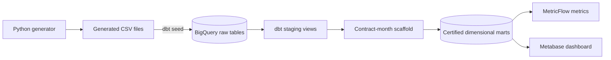
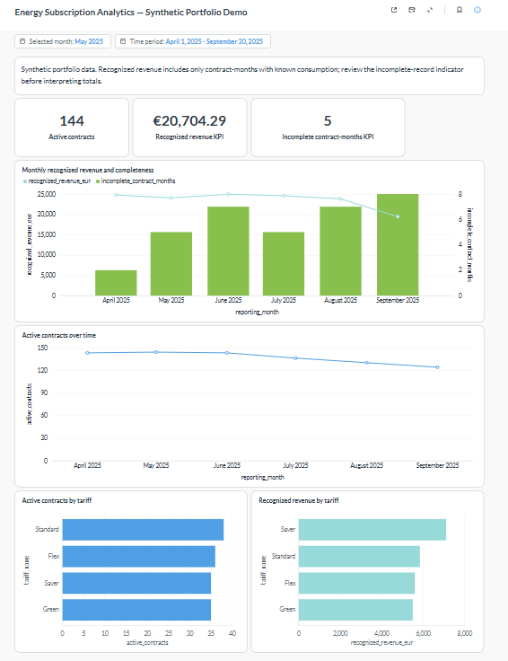

# Energy Subscription Analytics

> **Status:** Complete — the portfolio release was fully validated on November 2, 2026.

A small analytics-engineering portfolio project built with synthetic electricity-subscription data. The project demonstrates how customer, tariff, contract, and monthly consumption data can be transformed into tested and documented dimensional models in BigQuery with dbt, governed through MetricFlow metrics, and reported in Metabase.

This is a learning project, not a production billing system. It contains no real customer data.

## Project objective

The finished project will answer three questions:

1. How many contracts are active at the end of each reporting month?
2. How much revenue can be calculated from complete contract-month records?
3. How do contract counts and revenue vary by tariff?

The first release deliberately uses a narrow scope: Germany, EUR, calendar-month reporting, fixed tariff rates, and synthetic data only.

## Current progress

| Stage | Deliverable | Status |
|---|---|---|
| 1 | Scope and business rules | Complete |
| 2 | Local dbt and BigQuery setup | Complete |
| 3 | Deterministic synthetic source data | Complete |
| Architecture | Model boundaries, grains, lineage, and quality strategy | Complete |
| 4 | dbt sources and staging models | Complete |
| 5 | Dimensional marts | Complete |
| 6 | Data-quality tests | Complete |
| 7 | Documentation and MetricFlow metrics | Complete |
| 8 | Metabase dashboard | Complete |
| 9 | Final validation and portfolio polish | Complete |

Completed work includes:

- A reproducible Python data generator with a fixed random seed.
- Four synthetic source datasets loaded into BigQuery with `dbt seed`.
- Validated keys, relationships, date ranges, missing values, and measured-zero examples.
- A working dbt Core connection to BigQuery using local OAuth.
- An architecture baseline with explicit source and mart grains.
- Four documented dbt sources and four tested staging views in `esa_dev_staging`.
- A complete contract-month scaffold and four certified dimensional marts in `esa_dev_marts`.
- A test suite with 123 data tests and four mocked unit-test scenarios covering metric-critical rules.
- Generated dbt documentation with descriptions for all 10 models and every declared model column.
- A locally validated MetricFlow semantic model with active-contract and recognized-revenue metrics.
- A pinned local Metabase runtime and seven BigQuery-validated KPI/chart query templates.
- A completed local Metabase dashboard with three KPI cards, two monthly trends, two tariff breakdowns, and separate month and trend-period filters.

The final non-partial dbt build completed with `PASS=141`, `WARN=0`, `ERROR=0`, and `SKIP=0`.

## Architecture



The central fact is `fact_contract_monthly`, with one row per contract per calendar month in which the contract was active for at least one day. It includes months without an observed consumption record so that activity, base fees, and data completeness remain visible.

See [Architecture](./docs/architecture.md) for the full system context, dbt lineage, model grains, metric ownership, security boundaries, and non-goals.

## Synthetic source data

| Source | Grain | Rows | Key |
|---|---|---:|---|
| `customers` | One row per customer | 180 | `customer_id` |
| `tariffs` | One row per fixed tariff | 4 | `tariff_id` |
| `contracts` | One row per contract | 180 | `contract_id` |
| `monthly_consumption` | One observed row per contract and calendar month | 2,796 | `contract_id`, `consumption_month` |

The reporting period is January 2024 through December 2025. The generated fixture contains active, ended, and cancelled contracts; four tariffs; residential and small-business customers; partial service months; missing consumption; and measured zero consumption.

The complete monthly scaffold contains 2,867 contract-month rows. Of these, 71 have no source consumption record. A missing record or null consumption value means consumption is unknown; numeric zero means consumption was measured as zero.

## Business definitions

### Active contracts

A contract is active at month end when:

- Its start date is on or before the final calendar day of the month; and
- Its end date is absent or on or after that day.

Start and end dates are inclusive.

### Revenue

For each contract-month:

```text
base fee revenue = monthly base fee × active days / calendar days in month
usage revenue    = consumption kWh × tariff unit rate
total revenue    = base fee revenue + usage revenue
```

Base-fee and usage components are rounded to two decimal places before they are summed into total revenue.

Total revenue is null when consumption is unknown. Revenue reporting will therefore include a completeness indicator and will not silently convert missing consumption to zero.

## Dimensional model

| Model | Grain |
|---|---|
| `dim_customer` | One row per customer |
| `dim_tariff` | One row per tariff |
| `dim_contract` | One row per contract |
| `fact_contract_monthly` | One row per contract per active calendar month |

The marts are documented, tested, tagged `certified`, and will be exposed to Metabase instead of the raw or staging models.

Model names follow the project convention: `view_` for BigQuery views, `dim_` for dimension tables, and `fact_` for fact tables.

## Technology

- Python 3.11 for deterministic synthetic-data generation.
- dbt Core 1.12 with the BigQuery adapter and dbt-metricflow 0.15.
- Google BigQuery in the `EU` location.
- MetricFlow for locally validated semantic metric definitions.
- Metabase for reporting on physical BigQuery mart models.
- Git for version control.

Dependency versions are pinned in [requirements.txt](./requirements.txt).

## Repository structure

```text
.
├── data/generated/          # Reproducible synthetic CSV inputs
├── docs/
│   ├── architecture.md      # Architecture and model-design contract
│   └── stages/              # Stage-level decisions, tasks, and work logs
├── models/
│   ├── intermediate/        # Contract-month scaffold and daily time spine
│   ├── staging/             # Implemented sources and source-aligned views
│   └── marts/               # Certified dimensions and monthly fact
├── metabase/                # Local runtime, dashboard SQL, and setup guide
├── scripts/
│   └── generate_synthetic_data.py
├── tests/                   # Implemented singular business-rule tests
├── dbt_project.yml
├── PROJECT-ROADMAP.md
└── requirements.txt
```

Generated dbt artifacts, virtual environments, local profiles, and credentials are excluded through `.gitignore`.

## Reproduce the project

The commands below use PowerShell. On macOS or Linux, replace the virtual-environment activation command with `source .venv/bin/activate`.

### Prerequisites

- Python 3.11
- Git
- Google Cloud CLI
- A Google Cloud project with BigQuery enabled
- Permission to run BigQuery jobs and create datasets, tables, and views
- A BigQuery development dataset named `esa_dev` in the `EU` location

### 1. Create the Python environment

From the repository root:

```powershell
python -m venv .venv
.\.venv\Scripts\Activate.ps1
python -m pip install --upgrade pip
python -m pip install -r requirements.txt
dbt --version
mf --version
```

The project pins dbt Core, the BigQuery adapter, and the compatible local MetricFlow CLI in [requirements.txt](./requirements.txt).

### 2. Authenticate to Google Cloud

Authenticate with Application Default Credentials rather than storing a service-account key in the repository:

```powershell
gcloud auth application-default login
gcloud auth application-default set-quota-project YOUR_GCP_PROJECT_ID
```

Create or confirm the `esa_dev` dataset in the BigQuery `EU` location before continuing.

### 3. Configure the dbt profile

Create `%USERPROFILE%\.dbt\profiles.yml` outside the repository:

```yaml
energy_subscription_analytics:
  target: dev
  outputs:
    dev:
      type: bigquery
      method: oauth
      project: YOUR_GCP_PROJECT_ID
      dataset: esa_dev
      location: EU
      threads: 2
```

Replace `YOUR_GCP_PROJECT_ID` with the Google Cloud project that contains the development dataset. Profiles and credentials are intentionally excluded from Git.

Validate the installation, profile, credentials, and warehouse connection:

```powershell
dbt debug
dbt parse --no-partial-parse
```

### 4. Regenerate the synthetic inputs

The generated CSV files are versioned for review, but they can be reproduced deterministically:

```powershell
python scripts\generate_synthetic_data.py
```

The generator validates primary keys, foreign keys, date consistency, and the unique contract-month grain before writing the files. Re-running it with the current fixed seed produces identical contents.

### 5. Build and test everything

Run the complete project in dependency order:

```powershell
dbt build
```

This command:

1. Loads the four CSV seeds into `esa_dev`.
2. Tests the raw sources.
3. Builds the six BigQuery views in `esa_dev_staging`, including MetricFlow's daily time spine.
4. Builds and tests the three dimensions.
5. Runs four mocked unit tests before materializing the fact.
6. Builds `fact_contract_monthly` in `esa_dev_marts`.
7. Runs all warehouse data tests and reconciliations.

The verified build result is:

```text
4 seeds + 6 views + 4 tables + 4 unit tests + 123 data tests
PASS=141  WARN=0  ERROR=0  SKIP=0
```

### 6. Generate and browse dbt documentation

Generate the manifest, catalog, lineage, model descriptions, column descriptions, tests, and metric definitions:

```powershell
dbt docs generate
dbt docs serve
```

`dbt docs serve` prints a local URL for the documentation site. Stop the server with `Ctrl+C`. Generated files are written under `target/` and are intentionally excluded from Git.

## Run targeted validations

The complete `dbt build` command is the normal validation path. The following commands are useful while reviewing or debugging individual parts.

### Run only mocked calculation tests

```powershell
dbt test --select test_type:unit
```

These four fixtures are defined in [models/marts/_unit_tests.yml](./models/marts/_unit_tests.yml):

- Full-month revenue
- Partial-month base-fee proration
- Missing consumption
- Measured-zero consumption

Run one unit test by name:

```powershell
dbt test --select fact_contract_monthly_partial_month_revenue
```

### Run only warehouse data tests

```powershell
dbt test --select test_type:data
```

Run individual business-rule tests:

```powershell
dbt test --select assert_fact_revenue_formulas
dbt test --select assert_fact_calendar_consistency
dbt test --select assert_fact_activity_consistency
dbt test --select assert_fact_consumption_completeness
dbt test --select assert_non_negative_numeric_values
```

Singular data tests pass when their SQL returns zero invalid rows. Their definitions and descriptions are under [`tests/`](./tests/).

### Build a specific lineage

Build the fact together with its upstream dependencies and associated tests:

```powershell
dbt build --select +fact_contract_monthly
```

Build only the fact and its directly associated tests:

```powershell
dbt build --select fact_contract_monthly
```

### Preview modeled data

Preview the fact through its dbt model:

```powershell
dbt show --select fact_contract_monthly --limit 10
```

Inspect a specific contract-month directly in BigQuery through dbt:

```powershell
dbt show --inline 'select * from `YOUR_GCP_PROJECT_ID.esa_dev_marts.fact_contract_monthly` where contract_month_key = ''CON-0001-2024-05''' --limit 10
```

The verified result for that partial month is a €1.25 base fee, €11.76 usage revenue, and €13.01 total revenue.

### Discover project resources

```powershell
dbt ls --resource-type model --output name
dbt ls --resource-type unit_test --output name
dbt ls --resource-type test --output name
```

### Investigate a failure

Run the failing test by name with more logging:

```powershell
dbt --debug test --select TEST_NAME
```

dbt writes compiled SQL and run artifacts under `target/`. For a singular data test, open its compiled SQL under `target/compiled/energy_subscription_analytics/tests/` to see the exact query that returned invalid rows.

If PowerShell activation is restricted, every command can be run explicitly through the environment instead, for example:

```powershell
.\.venv\Scripts\dbt.exe build
```

## Validate and query the metrics

The project uses the dbt 1.12 model-embedded semantic specification in [models/marts/_marts.yml](./models/marts/_marts.yml). `fact_contract_monthly` is exposed as the `energy_contract_monthly` semantic model, and `reporting_month` is its monthly aggregation time dimension.

On Windows, point the self-hosted MetricFlow CLI to the same dbt profile directory and force UTF-8 console output before running `mf` commands:

```powershell
$env:DBT_PROFILES_DIR = "$env:USERPROFILE\.dbt"
$env:PYTHONIOENCODING = "utf-8"

dbt parse --no-partial-parse
mf validate-configs --show-all --verbose-issues
mf list metrics
```

Query both governed metrics by calendar month:

```powershell
mf query --metrics active_contracts,recognized_revenue_eur `
  --group-by metric_time__month `
  --order metric_time__month
```

Optionally save the result under the ignored `target/` directory:

```powershell
mf query --metrics active_contracts,recognized_revenue_eur `
  --group-by metric_time__month `
  --order metric_time__month `
  --csv target\metricflow_monthly.csv
```

| Metric | Definition | Aggregation behavior |
|---|---|---|
| `active_contracts` | Sum of the 0/1 month-end activity flag | Additive across contracts; not additive across months |
| `recognized_revenue_eur` | Sum of `total_revenue_eur` for records with calculable revenue | EUR; null incomplete records are excluded, never changed to zero |

Reconcile the semantic results with a direct aggregation over the certified fact:

```powershell
dbt show --inline "select reporting_month, sum(active_contract_count) as active_contracts, sum(total_revenue_eur) as recognized_revenue_eur, countif(not is_revenue_complete) as incomplete_contract_months from {{ ref('fact_contract_monthly') }} group by reporting_month order by reporting_month" --limit 30
```

The Stage 7 validation compared all 24 monthly MetricFlow rows with this independent query and found zero mismatches. Representative results are:

| Month | Active contracts | Recognized revenue | Incomplete contract-months |
|---|---:|---:|---:|
| 2024-01 | 75 | EUR 11,011.64 | 5 |
| 2025-05 | 144 | EUR 24,038.86 | 5 |
| 2025-12 | 117 | EUR 20,704.29 | 13 |

The incomplete count is deliberately shown beside revenue. It is a data-completeness indicator, not part of the two governed MetricFlow metrics.

## Run the local Metabase reporting layer

Stage 8 provides a pinned, localhost-only Metabase runtime, seven validated SQL templates, and a completed local dashboard with KPI, trend, completeness, and tariff views.

### Dashboard preview



*Metabase dashboard built from synthetic data in the certified BigQuery marts. The selected-month filter controls the KPI and tariff cards, while the time-period filter controls both monthly trend charts.*

```powershell
docker compose -f metabase\docker-compose.yml pull
docker compose -f metabase\docker-compose.yml up -d
docker compose -f metabase\docker-compose.yml ps
```

Open <http://localhost:3000> when the container is healthy. The named Docker volume preserves the locally built questions, dashboard, and connection settings. A fresh recreation requires a local Metabase administrator and a dedicated read-only BigQuery service-account JSON; neither credential is stored by this repository.

Follow [the Metabase setup guide](./metabase/README.md) to review the implemented charts, filters, layout, security boundary, recreation steps, and reconciliation values.

Stop Metabase without deleting the locally saved dashboard:

```powershell
docker compose -f metabase\docker-compose.yml down
```

## Expected warehouse objects

| Dataset | Relation | Type |
|---|---|---|
| `esa_dev` | `customers`, `tariffs`, `contracts`, `monthly_consumption` | Seed tables |
| `esa_dev_staging` | `view_customers`, `view_tariffs`, `view_contracts`, `view_monthly_consumption`, `view_contract_months`, `view_time_spine_daily` | Views |
| `esa_dev_marts` | `dim_customer`, `dim_tariff`, `dim_contract`, `fact_contract_monthly` | Tables |

## Final validation

The final review on November 2, 2026, verified the repository from regenerated inputs through the reporting layer:

- Synthetic-data regeneration produced no changes to the four tracked CSV files.
- `dbt debug` confirmed the local profile and BigQuery connection.
- `dbt build --no-partial-parse` rebuilt 4 seeds, 6 views, and 4 tables and passed 4 unit tests plus 123 data tests: `PASS=141`, `WARN=0`, `ERROR=0`, `SKIP=0`.
- `dbt docs generate --no-partial-parse` produced the manifest and BigQuery catalog.
- MetricFlow validated the semantic model, dimensions, entities, measures, and metrics with zero errors or warnings; both metrics returned all 24 reporting months.
- All seven versioned Metabase SQL templates executed successfully against the certified marts.
- The pinned Metabase container reported healthy, and its local health endpoint returned `ok`.
- The repository scan found no private keys, service-account JSON, API tokens, email addresses, tracked credentials, or broken local Markdown links.
- The only BigQuery resources retained are the three expected development datasets; the Data Transfer API is disabled, so the project has no scheduled transfer jobs.

Detailed evidence and completion criteria are recorded in [Stage 9](./docs/stages/09-final-validation-and-portfolio-polish.md).

## Suggested CV wording

**Energy Subscription Analytics — dbt + BigQuery | 2026**

Built a reproducible analytics-engineering portfolio project using synthetic customer, tariff, contract, and electricity-consumption data. Developed tested staging and dimensional marts in BigQuery with explicit grains and reconciliation rules, validated MetricFlow metrics for active contracts and recognized revenue, and delivered a Metabase dashboard over certified marts. Portfolio implementation; not a production billing system.

## Documentation

- [Architecture](./docs/architecture.md)
- [Project roadmap](./PROJECT-ROADMAP.md)
- [Stage 1 — Scope and business rules](./docs/stages/01-project-scope-and-business-rules.md)
- [Stage 2 — Project and tool setup](./docs/stages/02-project-and-tool-setup.md)
- [Stage 3 — Synthetic source data](./docs/stages/03-synthetic-source-data.md)
- [Stage 4 — Sources and staging models](./docs/stages/04-sources-and-staging-models.md)
- [Stage 5 — Dimensional marts](./docs/stages/05-dimensional-marts.md)
- [Stage 6 — Data-quality tests](./docs/stages/06-data-quality-tests.md)
- [Stage 7 — Documentation and metrics](./docs/stages/07-documentation-and-metrics.md)
- [Stage 8 — Metabase report](./docs/stages/08-metabase-report.md)
- [Stage 9 — Final validation and portfolio polish](./docs/stages/09-final-validation-and-portfolio-polish.md)

## Limitations

- One generated contract per customer in the first fixture.
- One fixed rate per tariff; no effective-dated tariff history.
- Monthly rather than smart-meter interval consumption.
- Recognized revenue excludes incomplete contract-months and must be read with the completeness indicator.
- MetricFlow is installed and validated locally; no hosted dbt Semantic Layer integration is claimed.
- The Metabase dashboard is implemented locally; its interactive state lives in a Docker volume, while Git contains the SQL and complete recreation instructions.
- No production billing, invoicing, forecasting, or orchestration behavior.
- Synthetic data and simplified rules are used throughout.

These constraints are intentional and keep the first portfolio release reproducible, inexpensive, and auditable.
