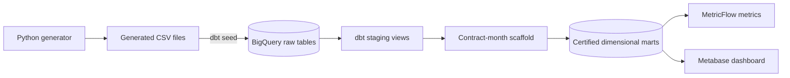

# Energy Subscription Analytics

> **Status:** In progress — source data, staging, and dimensional marts complete; focused data-quality tests are next.

A small analytics-engineering portfolio project built with synthetic electricity-subscription data. The project demonstrates how customer, tariff, contract, and monthly consumption data can be transformed into tested and documented dimensional models in BigQuery with dbt, governed through MetricFlow metrics, and reported in Metabase.

This is a learning project, not a production billing system. It contains no real customer data.

## Project objective

The finished project will answer three questions:

1. How many contracts are active at the end of each reporting month?
2. How much revenue can be calculated from complete contract-month records?
3. How do contract counts and revenue vary by tariff?

The first release deliberately uses a narrow scope: Germany, EUR, calendar-month reporting, fixed tariff rates, and synthetic data only.

## Current progress

| Stage | Deliverable | Status |
|---|---|---|
| 1 | Scope and business rules | Complete |
| 2 | Local dbt and BigQuery setup | Complete |
| 3 | Deterministic synthetic source data | Complete |
| Architecture | Model boundaries, grains, lineage, and quality strategy | Complete |
| 4 | dbt sources and staging models | Complete |
| 5 | Dimensional marts | Complete |
| 6 | Data-quality tests | Next |
| 7 | Documentation and MetricFlow metrics | Planned |
| 8 | Metabase dashboard | Planned |
| 9 | Final validation and portfolio polish | Planned |

Completed work includes:

- A reproducible Python data generator with a fixed random seed.
- Four synthetic source datasets loaded into BigQuery with `dbt seed`.
- Validated keys, relationships, date ranges, missing values, and measured-zero examples.
- A working dbt Core connection to BigQuery using local OAuth.
- An architecture baseline with explicit source and mart grains.
- Four documented dbt sources and four tested staging views in `esa_dev_staging`.
- A complete contract-month scaffold and four certified dimensional marts in `esa_dev_marts`.

No focused metric-formula test suite, MetricFlow definitions, or Metabase dashboard are claimed as complete yet.

## Architecture



The central fact is `fact_contract_monthly`, with one row per contract per calendar month in which the contract was active for at least one day. It includes months without an observed consumption record so that activity, base fees, and data completeness remain visible.

See [Architecture](./docs/architecture.md) for the full system context, dbt lineage, model grains, metric ownership, security boundaries, and non-goals.

## Synthetic source data

| Source | Grain | Rows | Key |
|---|---|---:|---|
| `customers` | One row per customer | 180 | `customer_id` |
| `tariffs` | One row per fixed tariff | 4 | `tariff_id` |
| `contracts` | One row per contract | 180 | `contract_id` |
| `monthly_consumption` | One observed row per contract and calendar month | 2,796 | `contract_id`, `consumption_month` |

The reporting period is January 2024 through December 2025. The generated fixture contains active, ended, and cancelled contracts; four tariffs; residential and small-business customers; partial service months; missing consumption; and measured zero consumption.

The complete monthly scaffold contains 2,867 contract-month rows. Of these, 71 have no source consumption record. A missing record or null consumption value means consumption is unknown; numeric zero means consumption was measured as zero.

## Business definitions

### Active contracts

A contract is active at month end when:

- Its start date is on or before the final calendar day of the month; and
- Its end date is absent or on or after that day.

Start and end dates are inclusive.

### Revenue

For each contract-month:

```text
base fee revenue = monthly base fee × active days / calendar days in month
usage revenue    = consumption kWh × tariff unit rate
total revenue    = base fee revenue + usage revenue
```

Total revenue is null when consumption is unknown. Revenue reporting will therefore include a completeness indicator and will not silently convert missing consumption to zero.

## Dimensional model

| Model | Grain |
|---|---|
| `dim_customer` | One row per customer |
| `dim_tariff` | One row per tariff |
| `dim_contract` | One row per contract |
| `fact_contract_monthly` | One row per contract per active calendar month |

The marts are documented, tested, tagged `certified`, and will be exposed to Metabase instead of the raw or staging models.

Model names follow the project convention: `view_` for BigQuery views, `dim_` for dimension tables, and `fact_` for fact tables.

## Technology

- Python 3.11 for deterministic synthetic-data generation.
- dbt Core 1.12 with the BigQuery adapter.
- Google BigQuery in the `EU` location.
- MetricFlow for locally validated semantic metric definitions.
- Metabase for reporting on physical BigQuery mart models.
- Git for version control.

Dependency versions are pinned in [requirements.txt](./requirements.txt).

## Repository structure

```text
.
├── data/generated/          # Reproducible synthetic CSV inputs
├── docs/
│   ├── architecture.md      # Architecture and model-design contract
│   └── stages/              # Stage-level decisions, tasks, and work logs
├── models/
│   ├── intermediate/        # Complete contract-month scaffold
│   ├── staging/             # Implemented sources and source-aligned views
│   └── marts/               # Certified dimensions and monthly fact
├── scripts/
│   └── generate_synthetic_data.py
├── tests/                   # Planned singular dbt tests
├── dbt_project.yml
├── PROJECT-ROADMAP.md
└── requirements.txt
```

Generated dbt artifacts, virtual environments, local profiles, and credentials are excluded through `.gitignore`.

## Local setup

Prerequisites:

- Python 3.11
- Git
- A Google Cloud project with BigQuery enabled
- A BigQuery dataset in the `EU` location
- Local Google Application Default Credentials

From PowerShell in the project directory:

```powershell
python -m venv .venv
.\.venv\Scripts\Activate.ps1
python -m pip install -r requirements.txt
dbt --version
```

Configure the `energy_subscription_analytics` dbt profile outside the repository in `%USERPROFILE%\.dbt\profiles.yml`. This project currently targets `tenji-446218.esa_dev` in `EU`. See [Stage 2](./docs/stages/02-project-and-tool-setup.md) for the setup and authentication decisions.

Validate the configuration:

```powershell
dbt debug
dbt parse --no-partial-parse
```

## Regenerate and load the source data

Generate the deterministic CSV files:

```powershell
python scripts\generate_synthetic_data.py
```

Load or refresh the four BigQuery seed tables:

```powershell
dbt seed
```

The generator validates primary keys, foreign keys, date consistency, and the unique contract-month grain before writing the files. Re-running it with the current configuration produces identical file contents.

## Next implementation milestone

Stage 6 will add:

- Focused range and accepted-value tests for numeric and flag fields.
- Revenue-formula, proration, and completeness tests.
- Reconciliation tests for the monthly fact and its aggregations.
- Controlled failure checks showing that invalid records are detected.

Implementation details and completion criteria are recorded in [Stage 6](./docs/stages/06-data-quality-tests.md).

## Documentation

- [Architecture](./docs/architecture.md)
- [Project roadmap](./PROJECT-ROADMAP.md)
- [Stage 1 — Scope and business rules](./docs/stages/01-project-scope-and-business-rules.md)
- [Stage 2 — Project and tool setup](./docs/stages/02-project-and-tool-setup.md)
- [Stage 3 — Synthetic source data](./docs/stages/03-synthetic-source-data.md)
- [Stage 4 — Sources and staging models](./docs/stages/04-sources-and-staging-models.md)
- [Stage 5 — Dimensional marts](./docs/stages/05-dimensional-marts.md)
- [Stage 6 — Data-quality tests](./docs/stages/06-data-quality-tests.md)
- [Stage 7 — Documentation and metrics](./docs/stages/07-documentation-and-metrics.md)
- [Stage 8 — Metabase report](./docs/stages/08-metabase-report.md)
- [Stage 9 — Final validation and portfolio polish](./docs/stages/09-final-validation-and-portfolio-polish.md)

## Limitations

- One generated contract per customer in the first fixture.
- One fixed rate per tariff; no effective-dated tariff history.
- Monthly rather than smart-meter interval consumption.
- No production billing, invoicing, forecasting, or orchestration behavior.
- Synthetic data and simplified rules are used throughout.

These constraints are intentional and keep the first portfolio release reproducible, inexpensive, and auditable.
