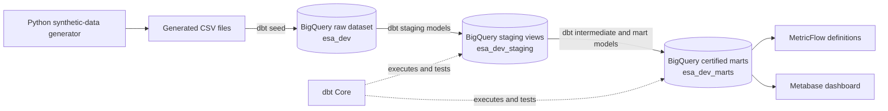
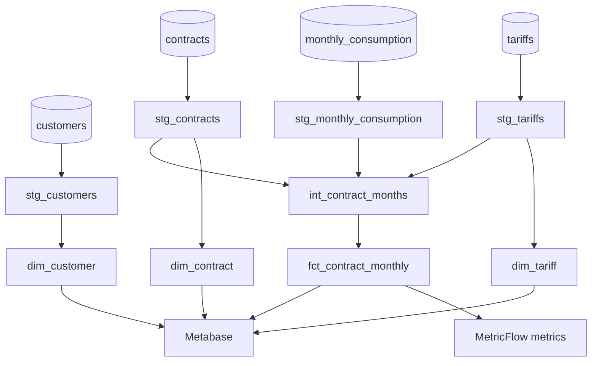

# Energy Subscription Analytics — Architecture

## Purpose

This document is the design contract for the first portfolio release. It defines the system boundaries, data flow, model layers, grains, metric ownership, and quality controls before transformation SQL is implemented.

The architecture is intentionally small. It demonstrates sound analytics-engineering practices without imitating a production energy platform.

## Scope and status

Implemented today:

- Deterministic synthetic-data generation in Python.
- Four generated CSV files for customers, tariffs, contracts, and monthly consumption.
- Four corresponding dbt seeds loaded into `tenji-446218.esa_dev` in the BigQuery `EU` location.
- A working local dbt Core connection using OAuth.
- Four documented dbt sources and four tested staging views in `esa_dev_staging`.
- A complete contract-month scaffold in `esa_dev_staging`.
- Three certified dimensions and `fct_contract_monthly` in `esa_dev_marts`.

Planned next:

- Focused business-rule data tests and two MetricFlow metrics.
- A Metabase dashboard that queries only final mart models.

## System context

MetricFlow and Metabase are separate consumers of the same certified mart. Metabase will query physical BigQuery mart tables rather than depending on a hosted dbt Semantic Layer integration.

## Data flow and dbt lineage

All downstream references will use dbt `source()` or `ref()` relationships. No mart will query a raw table directly.

## Layer responsibilities

| Layer | Responsibility | Materialization | BigQuery dataset |
|---|---|---|---|
| Raw | Preserve reproducible synthetic inputs with explicit types | Seed tables | `esa_dev` |
| Staging | Rename, cast, normalize, and expose source fields without business calculations | Views | `esa_dev_staging` |
| Intermediate | Create the complete contract-month scaffold and reusable business-rule calculations | Views | `esa_dev_staging` |
| Marts | Publish documented dimensions and the analysis-ready monthly fact | Tables | `esa_dev_marts` |
| Semantic | Define governed metric names and aggregations on the certified fact | MetricFlow YAML | Not applicable |
| Reporting | Present a small set of reconciled business views | Metabase questions/dashboard | Not applicable |

The physical dataset names assume dbt's standard target-schema prefix behavior with the development target `esa_dev`.

## Source entities and grains

| Source | Grain | Key |
|---|---|---|
| `customers` | One row per synthetic customer | `customer_id` |
| `tariffs` | One row per fixed tariff | `tariff_id` |
| `contracts` | One row per contract | `contract_id` |
| `monthly_consumption` | One observed record per contract and calendar month | `contract_id`, `consumption_month` |

An absent monthly-consumption row and a present row with a null consumption value both mean that consumption is unknown. A numeric zero is a measured value and must remain distinct from missing data.

## Mart models and grains

| Model | Grain | Purpose |
|---|---|---|
| `dim_customer` | One row per customer | Customer segment, signup date, and region |
| `dim_tariff` | One row per tariff | Tariff name, monthly base fee, unit rate, and region |
| `dim_contract` | One row per contract | Customer/tariff relationships, service dates, and status |
| `fct_contract_monthly` | One row per contract per calendar month in which it was active for at least one day | Activity, consumption, revenue components, and completeness |

The monthly fact is deliberately not limited to observed consumption records. The current fixture should produce 2,867 contract-month rows: 2,796 with a consumption record and 71 without one. This scaffold preserves base-fee and activity information when consumption is missing.

The fact's natural key is `contract_id` plus `reporting_month`. A deterministic `contract_month_key` may also be exposed for convenient testing and downstream use.

## Monthly fact rules

For every contract-month in the January 2024 through December 2025 reporting window:

1. `reporting_month` is the first calendar day of the month.
2. `active_days` is the inclusive overlap between the contract service period and the calendar month.
3. `is_active_at_month_end` is true when the start date is on or before month end and the end date is absent or on or after month end.
4. `base_fee_revenue_eur` is the monthly base fee multiplied by `active_days / days_in_month`.
5. `usage_revenue_eur` is consumption in kWh multiplied by the fixed tariff unit rate.
6. `total_revenue_eur` is base-fee revenue plus usage revenue when consumption is known; otherwise it is null.
7. `is_revenue_complete` is true only when consumption is known, including a measured zero.

Contract start and end dates are inclusive. The first version uses one fixed rate per tariff and EUR only.

## Metrics

### Active contracts

- Metric name: `active_contracts`
- Source model: `fct_contract_monthly`
- Calculation: sum the integer form of `is_active_at_month_end`
- Required time dimension: `reporting_month`
- Default reporting grain: calendar month

### Revenue

- Metric name: `recognized_revenue_eur`
- Source model: `fct_contract_monthly`
- Calculation: sum `total_revenue_eur` for complete contract-month records
- Required time dimension: `reporting_month`
- Default reporting grain: calendar month
- Currency: EUR

Revenue must be shown with an incomplete contract-month count or completeness rate. Missing consumption must not be silently treated as zero, and the displayed revenue must be labelled as calculated from complete records when incomplete records exist.

## Data-quality strategy

Quality controls are applied at the earliest useful layer:

- Source tests: required identifiers, uniqueness, accepted statuses, and relationships between raw entities.
- Staging tests: standardized fields retain valid types and required values.
- Mart tests: primary keys, fact grain, fact-to-dimension relationships, non-negative measures, and valid date order.
- Singular business-rule tests: active-day bounds, revenue formula, proration, and missing-consumption behavior.
- Reconciliation checks: expected source and fact row counts plus manually checked sample contracts.

A valid build must fail on duplicate contract-month rows, orphaned keys, or revenue that contradicts the documented formula.

## Certified reporting interface

The three dimensions and `fct_contract_monthly` are the public reporting interface. They are:

- Described in dbt YAML.
- Tagged `certified`.
- Tested for primary-key uniqueness, required fields, and relationships.
- Built in `esa_dev_marts` so Metabase can be restricted to final models.

Enforced dbt model contracts remain optional portfolio hardening for the documentation stage.

Staging and intermediate models are implementation details and are not intended as reporting sources.

## Security and cost boundaries

- Only synthetic data is permitted.
- OAuth credentials, service-account JSON, local profiles, and tokens must remain outside Git.
- dbt uses local user OAuth for development.
- Metabase will use a dedicated read-only service account scoped to the required BigQuery datasets.
- Data volumes remain small, and no incremental processing, orchestration service, or always-on compute is required.

## First-version non-goals

- Smart-meter interval data.
- Effective-dated tariff histories.
- Multiple currencies or countries.
- Customer identity or personally identifiable information.
- Slowly changing dimensions or dbt snapshots.
- Incremental models, orchestration, or production deployment.
- Forecasting, anomaly detection, or machine learning.
- A production-grade billing calculation.

These may be documented as future extensions but must not delay the first complete portfolio release.

## Architecture acceptance checks

Before implementation proceeds:

- Every planned model has one explicit grain.
- Missing and zero consumption have different meanings.
- The complete contract-month scaffold is the source of both headline metrics.
- MetricFlow and Metabase consume certified marts rather than raw or staging data.
- Planned tests cover keys, relationships, grain, and metric-critical business rules.
- The design remains reproducible with synthetic data and a small BigQuery footprint.

